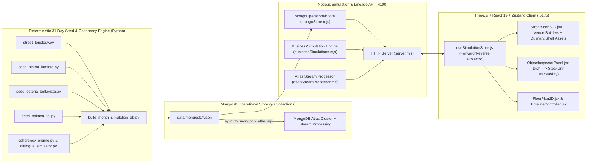

# Multi-Venue 3D Hospitality Street Simulation Platform

An end-to-end **3D Hospitality Street Simulation, Physical Inventory Lineage, and MongoDB Atlas Stream Processing Platform** modeling a bustling culinary boulevard (`street-london-001` — *Boulevard de la Gastronomie*) across three distinct, architecturally detailed restaurants over a full 31-day operational month (`2026-10-01` to `2026-10-31`).

---

## Architecture Overview



---

## The Three Restaurants on *Boulevard de la Gastronomie*

| Restaurant | Business ID / Premises ID | Culinary Specialty | Bespoke 3D Interior & Stations |
| :--- | :--- | :--- | :--- |
| **Bistrot Lumière** | `business-bistrot-lumiere` / `premises-bistrot-lumiere` | French Brasserie & Cuisine Niçoise (*Entrecôte grillée maître d'hôtel*, *Bouillabaisse*, *Soupe à l'oignon gratinée*) | Art Deco brass storefront, red velvet banquettes, *Le Zinc* pewter bar with back-lit liqueur shelves, *Charvet* 8-burner central island with copper sauté battery, framed *Passe Chaude* with copper heat lamps, and Parisian awning terrace. |
| **Osteria Bellavista** | `business-osteria-bellavista` / `premises-osteria-bellavista` | Tuscan Trattoria & Wood-Fired Grill (*Bistecca alla Fiorentina*, *Tagliatelle al Ragù*, *Pappardelle al Cinghiale*) | Brick-arch *Griglia Toscana a Legna* with glowing oak embers & wrought-iron hood, 6-basket brass *Bollitore Pasta Fresca*, Carrara marble *Sfogliatura* bench with wooden pasta drying racks, floor-to-ceiling *Enoteca* Chianti wine wall, and Tuscan olive-tree terrace. |
| **Sakana-Tei 魚亭** | `business-sakana-tei` / `premises-sakana-tei` | Hinoki Omakase Sushi & Binchotan Robatayaki (*Omakase Nigiri sur Geta*, *Black Cod Misoyaki*, *Wagyu A5 Tataki*) | L-shaped Hinoki cypress *Omakase* counter with curved glass *Neta* sashimi display, sunken *Binchotan Robatayaki* charcoal hearth with skewered yakitori, copper *Tempura & Ramen* cauldron station, glowing *Chōchin* lanterns, *Noren* entry curtains, and bamboo courtyard. |

---

## Key Capabilities

### 1. Full Causal Dining Lifecycle & Articulated 3D Characters
Every dining party follows a strict, causally validated lifecycle with zero early departures:
1. **Arrival (`ARRIVING`)**: Guests spawn on the boulevard sidewalk and walk along A* waypoints through the restaurant entrance to their assigned table.
2. **Seating & Ordering (`SEATED`, `PARTY_SEATED`, `ORDER_CREATED`)**: Guests sit in exact chair slots around the table matching `partySize`; a waiter approaches the table, takes the order with simulated bilingual/venue-authentic dialogue, and enters it at the POS.
3. **Kitchen & Bar Preparation (`COOKING_STARTED` → `ITEM_PLATED`)**: Cooks pick discrete physical ingredients from sorted cold/dry shelves (`INGREDIENT_PICKED_FROM_SHELF`), deduct exact recipe grammage (`INGREDIENT_PORTIONED`), cook at the station with 3D cookware, and plate dishes to the pass (`ITEM_PLATED`).
4. **Table Service & Seat-Accurate Plating (`ORDER_SERVED` → `MEAL_CONSUMED`)**: Waiters carry dishes under a silver cloche/tray from the pass to the table; 3D plated dishes render strictly for the seated `partySize` (never over-plating empty chairs).
5. **Bill Request & POS/TPE Payment (`BILL_REQUESTED` → `WAITER_FETCHING_BILL` → `BILL_DELIVERED` → `PAYMENT_COMPLETED`)**:
   - The lead guest raises their hand holding a 3D gold payment card (`REQUESTING_BILL`) with a `💳 L'addition SVP` badge.
   - The assigned waiter walks to the POS terminal (`pos-*-main`) to print the check and pick up the wireless TPE terminal (`FETCHING_BILL`), then walks to the table carrying a 3D leather bill folder + glowing TPE terminal (`BRINGING_BILL`).
   - The guest taps their card (`PAYING_BILL` / `PAID_SEATED`) before departing (`CUSTOMER_DEPARTED` / `DEPARTING`) back onto the boulevard sidewalk.
6. **Table Clearing & Plonge Dishwashing (`TABLE_CLEARING_STARTED` → `TABLE_CLEARED` → `DISHES_WASHED_AT_PLONGE`)**:
   - Vacated tables transition to `NEEDS_CLEARING` with dirty plates remaining on the table.
   - A waiter walks to the table and wipes the surface with an animated 3D blue microfiber cloth (`CLEARING_TABLE`), stacks the dirty dishes onto a bussing tray, and walks along the A* path to the dishwashing station (`BUSSING_TO_PLONGE`), where the Plongeur washes them at 85°C.

### 2. Sorted 3D Shelves, FIFO Stock Units & Resource Contention
- **3-Tier × 6-Slot Sorted Storage Racks**: Every cold room, dry pantry, and back-bar shelf renders discrete physical containers (`unitId` / `scene-unit-*`) with color-coded fill-level bars and `#1 NEXT TO USE` FIFO badges.
- **First-Come-First-Served (FCFS) Contention**: When two cooks require the same single-unit ingredient (e.g., a 150g cucumber where two dishes each need 30g), the first cook locks the unit (`UNIT_LOCKED_BY_COOK`) while the second cook logs a contention event (`INGREDIENT_CONTENTION_WAIT`), gathers remaining recipe items first (`COOK_GATHERING_OTHER_ITEMS`), and retries once the unit is returned with its updated remaining weight (`150g → 120g → 90g`).
- **Single-Bottle Barman Constraint**: Bartenders can hold and pour at most one bottle (`maxSimultaneousBottlesHeldByBarman == 1`) from the back-bar shelf at a time (`BARMAN_BOTTLE_TAKEN` → `BARMAN_DRINK_POURED` → `BARMAN_BOTTLE_RETURNED`).

### 3. Bidirectional Provenance & Reverse Time-Travel Playback
- **Dish → Cook → Stock Reverse Playback**: Click any 3D plated dish on a table (`scene-dish-*`) or in the Inspector Panel and trigger **`⏪ Rembobiner jusqu'au Stock`** to play time backward (`-1x`, `-2x`, `-5x`, `-15x`), watching the waiter carry the dish back to the pass, the cook un-plate it at the stove, and the exact ingredient portions return to their physical shelf containers.
- **Stock Unit → Kitchen Forward/Reverse Trace**: Click any 3D container on a fridge, dry rack, or bar shelf (`scene-unit-*`) to inspect its complete slice ledger and follow it forward (`⏩ Suivre vers la Cuisine`) or backward in time.

---

## Repository Structure

| Directory | Description | Documentation |
| :--- | :--- | :--- |
| [`backend/`](file:///Users/ag/Workspace/restaurants/backend) | Node.js HTTP API server (`:4100`), in-memory indexed MongoDB operational store, deterministic event projector, and MongoDB Atlas Stream Processing pipelines. | [`backend/README.md`](file:///Users/ag/Workspace/restaurants/backend/README.md) |
| [`frontend/`](file:///Users/ag/Workspace/restaurants/frontend) | React 19 + Three.js + Zustand + React-Konva 3D street & interior viewport (`:5175`), bespoke restaurant builders, culinary/shelf 3D assets, and lineage inspector UI. | [`frontend/README.md`](file:///Users/ag/Workspace/restaurants/frontend/README.md) |
| [`scripts/`](file:///Users/ag/Workspace/restaurants/scripts) | Python 31-day multi-restaurant deterministic simulation builder, street topology, FIFO coherency engine, dialogue simulator, and MongoDB Atlas sync utility. | [`scripts/README.md`](file:///Users/ag/Workspace/restaurants/scripts/README.md) |
| [`data/`](file:///Users/ag/Workspace/restaurants/data) | Output directory (`data/mongodb/`) for the 26 generated MongoDB JSON collections and migration validation report. | [`data/README.md`](file:///Users/ag/Workspace/restaurants/data/README.md) |
| [`docs/`](file:///Users/ag/Workspace/restaurants/docs) | System architecture and PostgreSQL-to-MongoDB migration specification (`ARCHITECTURE_AND_MIGRATION_PLAN.md`). | [`docs/ARCHITECTURE_AND_MIGRATION_PLAN.md`](file:///Users/ag/Workspace/restaurants/docs/ARCHITECTURE_AND_MIGRATION_PLAN.md) |
| [`lumiere/`](file:///Users/ag/Workspace/restaurants/lumiere) | Original Bistrot Lumière accounting/catalog seed definitions used as baseline reference data. | [`lumiere/README.md`](file:///Users/ag/Workspace/restaurants/lumiere/README.md) |

---

## Quickstart

### Prerequisites
- **Node.js** `>= 20.x`
- **Python** `>= 3.11`

### 1. Build (or Rebuild) the 31-Day Multi-Restaurant MongoDB Dataset
If `data/mongodb/simulationEvents.json` is not yet generated on disk, the backend will automatically build it on startup, or you can run the generator directly:
```bash
python3 scripts/build_month_simulation_db.py
```

### 2. Start the Backend Simulation & Lineage Server (`http://localhost:4100`)
```bash
node backend/server.mjs
```
The backend loads all 26 collections into an indexed operational store and serves both the REST API (`/api/*`), 3D GLB models (`/assets/*.glb`), and the production frontend bundle (`frontend/dist`).

### 3. Start the Frontend Development Server (`http://localhost:5175`)
```bash
cd frontend
npm install
npm run dev -- --port 5175 --host
```

### 4. Production Frontend Build
```bash
cd frontend
npm run build
```

### 5. Optional: Sync Collections & Indexes to MongoDB Atlas
```bash
MONGODB_URI="mongodb+srv://<user>:<password>@<cluster>.mongodb.net/" node scripts/sync_to_mongodb_atlas.mjs
```

---

## 3D Navigation & Controls

- **Orbit / Pan / Zoom**: Left-drag to orbit, Right-drag to pan, Scroll wheel to zoom.
- **First-Person / Street Walk (`WASD` / Arrow Keys)**:
  - `W` / `↑` — Move forward along camera heading
  - `S` / `↓` — Move backward
  - `A` / `←` — Strafe left
  - `D` / `→` — Strafe right
  - `Q` / `E` — Elevate camera up / down
  - `Shift` — Sprint (`2.4x` speed)
  - **Mode Piéton (WASD)**: Toggle eye-level (`1.7m`) pedestrian walk mode from the top-left HUD.
- **Quick Venue Camera Presets**: Switch instantly between **Vue Rue Globale**, **Bistrot Lumière**, **Osteria Bellavista**, and **Sakana-Tei 魚亭**.
- **Interactive Inspection**: Click any **guest**, **waiter/chef**, **dining table**, **plated 3D dish (`scene-dish-*`)**, **kitchen/bar station**, or **3D shelf container (`scene-unit-*`)** to inspect its live state and launch forward or reverse provenance playback.
